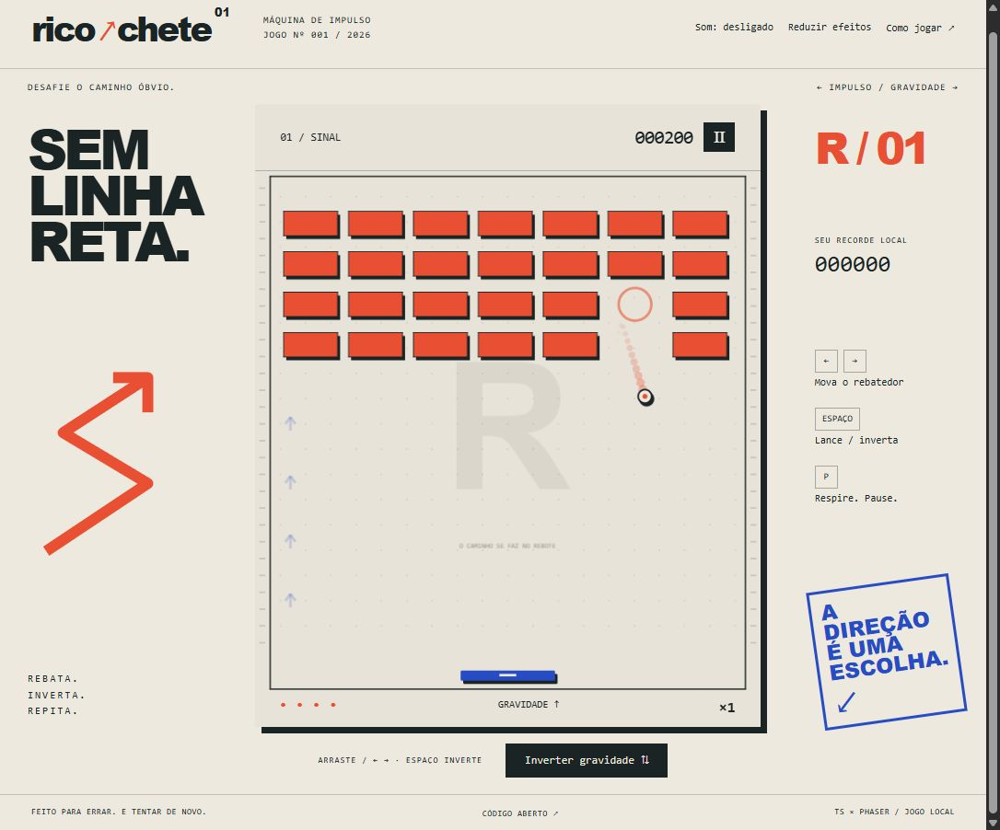

# Ricochete ↗

Uma máquina de impulso: rebata o pulso, inverta a gravidade e encontre novos ângulos em cinco arenas autorais. Um arcade de precisão com papel, tinta, coral e cobalto.

**[Jogar no navegador](https://gustapaz.github.io/ricochete/)**



## Jogar

| Ação | Controle |
|---|---|
| Mover | ← →, A/D, mouse ou arrastar na arena |
| Lançar / inverter gravidade | Espaço ou botão abaixo da arena |
| Pausar | P, Escape ou botão Ⅱ |
| Retomar | P/Escape no painel de pausa ou Continuar |

Destrua os alvos para avançar. Alvos com miolo claro/escuro exigem dois contatos; o primeiro deixa uma marca. As bordas do rebatedor abrem o ângulo. Inversões têm recarga de 0,8 segundo. Acertos consecutivos aumentam o multiplicador até ×5. Perder a bola consome uma das cinco cargas e encerra a sequência; cada arena concluída recupera uma carga (máximo cinco). Limpe Ressonância para vencer. O recorde é **local**, sem placar global.

## Executar

Node.js 24 LTS e npm.

```sh
npm ci
npm run dev
npm test
npm run build
npm run preview
```

Abra a URL exibida com `/ricochete/`. Vite tem base explícita para GitHub Pages. O workflow testa, audita dependências, compila e publica somente `dist/`. `src/model.ts` mantém regras e colisões independentes do renderer; `src/main.ts` integra Phaser Canvas, controles DOM, áudio Web Audio e persistência validada. Simulação fixa de 120 Hz com recuperação de atraso limitada e subpassos para colisões.

## Escopo e privacidade

Jogo single-player inteiramente local. Sem login, servidor, banco de dados, analytics, publicidade, compras ou chaves de API. Recorde, áudio e efeitos ficam em `localStorage`, com fallback se indisponível. O site precisa de conexão para carregar; funcionamento offline não é prometido. GitHub Pages está disponível para repositórios públicos no [GitHub Free](https://docs.github.com/en/pages/getting-started-with-github-pages/what-is-github-pages). Não é necessário cadastrar cartão ou ativar faturamento para jogar/hospedar esta demo pública.

Menus e instruções são HTML, com teclado, foco visível e anúncios de transição; áudio é opcional e começa desligado. Movimento reduzido respeita a preferência do sistema e tem controle próprio. A partida visual em Canvas não oferece equivalência completa para leitores de tela. Testes de viewport não equivalem a teste em dispositivo físico; detalhes em [validação](docs/validation.md).

Arte e áudio procedurais originais; [licenças](docs/assets.md). Código sob [MIT](LICENSE).
